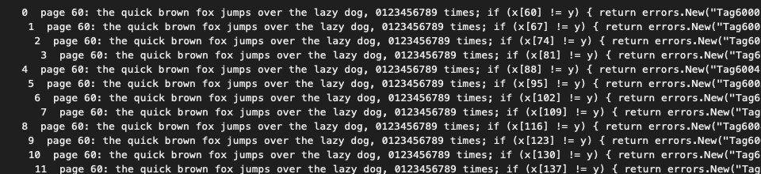
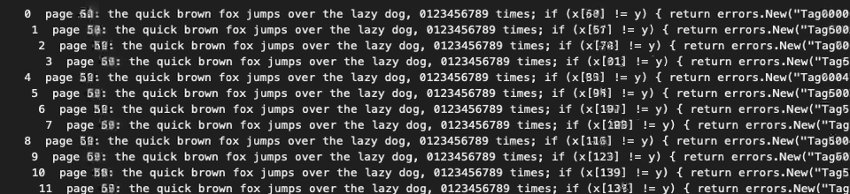
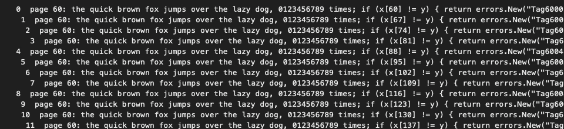
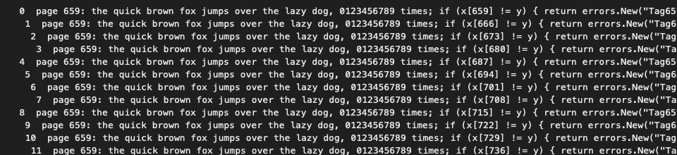
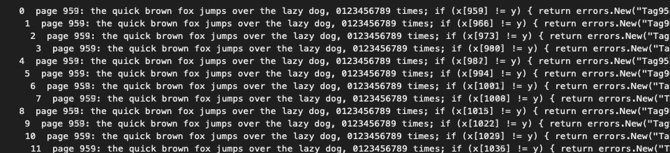
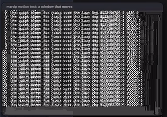
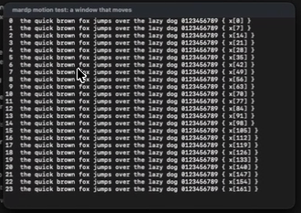

# Performance

The measurements of milestone M6 against the targets of [SPEC §14](SPEC.md#14-performance-targets). Each section says how a number was measured and on what; a change that moves a number has its before and after here.

## How to measure

```sh
scripts/perf.sh                     # 60 seconds
MARDP_PERF_SECONDS=300 scripts/perf.sh
```

`scripts/perf.sh` builds mardp and runs `mardp -headless -test-pattern -measure` with its settings in a temporary folder (SPEC §13, §15.5). The test pattern is drawn into the encoder's own buffers and encoded by VideoToolbox at 60 frames a second, as a capture would hand them over; the sound is a tone through the AAC encoder. `rdptest`, on the same Mac, connects at 1920×1080 with H.264 (AVC420) and sound, acknowledges every frame at once and confirms every sound block. The script needs no permission and posts nothing to the Mac.

What it reports:

- **Frames delivered**: H.264 frames the client got and acknowledged, each second; the first second (the session's start) is left out of the mean.
- **Host delay**: from mardp's own "session video timing" log line (`-measure`): from the capture of a frame to the end of the write of its last byte to the socket, and each stage between. With the test pattern the capture time is the moment the picture was handed to the encoder.
- **Bitrate**: by mardp's log (bytes written over the span of the writes) and by the client (the H.264 bytes it got over the watch).
- **CPU**: the user and system time of the mardp process, from its resource usage when it exits, over the watch.
- **Memory**: the resident memory of the mardp process, each second (`ps`), and its largest (resource usage).

It fails when a target it measures is missed. What it cannot measure (the delay from screen to screen, the sound and the picture apart, the real screen's capture, the network) is measured by hand with the owner's Linux machine (6.3).

## First numbers (6.1, 2026-11-19)

Apple M6, macOS 27.2; 60 seconds; the default settings (60 frames a second, 20 Mbit/s cap, sound on the client).

| What | Target (§14) | Measured |
|---|---|---|
| Frames delivered | ≥ 57 of 60 a second | mean 60.0, fewest 60 in a second; 0 of 59 seconds under 57 |
| Host delay, capture to written | ≤ 25 ms for 95% | p50 5.8 ms, p95 6.1 ms, p99 6.3 ms, max 32.5 ms |
| — capture to encoded | | p50 5.7 ms, p95 6.0 ms |
| — encoded to queued | | p95 0.1 ms |
| — queued to written | | p95 0.2 ms |
| Sound blocks confirmed | no dropout | 2813, 46.9 a second (AAC: 1024 samples at 48 kHz, 46.875 a second) |
| CPU of mardp | < 60% of one core | 14.9% (8.95 s in 60 s) |
| Memory of mardp | < 300 MB, not growing | 76.2 MB after 1 s, 77.1 MB at the end, 77.2 MB at most |
| Bitrate | ≤ cap (20 Mbit/s) | 18.5 Mbit/s by the log, 18.1 Mbit/s at the client; 1 key frame |

Notes:

- Almost all of the host's delay is the encoder: VideoToolbox takes about 5.7 ms a 1080p frame. Handing the frame to `rdp` and writing it to the loopback socket take a few tenths of a millisecond.
- The maximum (32.5 ms) is the first frame, the key frame of the encoder's start.
- The test pattern's moving square is a gradient with noise, harder to encode than most desktops, so the bitrate sits near the cap: the rate control of §9.5 holds it there.
- The loopback has no network delay: the write stage is the time to hand the bytes to TLS and the kernel, not to the client. Over the LAN the write stage grows with the network (6.3).

## Allocations (6.2, 2026-11-19)

SPEC §11 rule 2: nothing allocates per frame or per sound packet once a session's buffers have grown. Each benchmark below fails when its loop allocates (more than once in a thousand operations, the runtime's own background allocations); tests with `testing.AllocsPerRun` assert the same in the default run.

```sh
go test ./rdp ./internal/host -run '^$' -bench 'SendFrame|SendTiles|SendRects|AudioWrite|Writer|AVCFrame|SoundBuffer'
```

Apple M6:

| Benchmark | What one operation is | Time | Allocations |
|---|---|---|---|
| `rdp` SendFrame/4KiB | an H.264 frame sent, framed for the graphics pipeline, written, acknowledged, with the write hook | 0.88 µs | 0 |
| `rdp` SendFrame/64KiB | the same | 6.6 µs (9.9 GB/s) | 0 |
| `rdp` SendFrame/512KiB | the same, a large key frame | 43 µs (12 GB/s) | 0 |
| `rdp` SendTiles | a frame of tiles (640×360 and 64×64) on the graphics pipeline, Planar | 2.2 ms | 0 |
| `rdp` SendRects | 1024×768 as fast-path bitmaps, Planar | 7.8 ms | 0 |
| `rdp` AudioWrite/3KiB | 20 ms of PCM written on the sound channel | 0.71 µs | 0 |
| `rdp` AudioWrite/400B | an AAC frame's size | 0.46 µs | 0 |
| `rdp` Writer/64B–256KiB | an update queued and written | 0.30–5.3 µs | 0 |
| `internal/host` AVCFrame | an encoded frame handed to the session by the H.264 path, with its flow decisions, measured as `-measure` does | 77 ns | 0 |
| `internal/host` SoundBuffer | 10 ms of captured sound encoded as PCM and written | 0.67 µs | 0 |

What it fixed: the sound path made a method value of its packet function for each captured buffer, one allocation every 10 ms; it is made once now.

## The table of §14 (6.3)

Each row with what is measured so far. "This Mac" is `scripts/perf.sh` (the test pattern through VideoToolbox, `rdptest` on the loopback; 20 and 60 second runs, 2026-11-19); "owner" is the manual check 6.3 of `docs/MANUAL-CHECKS.md`, with the owner's Mac and Linux machine on their LAN, still pending. On the loopback, with a client that acknowledges at once, no frame is skipped and the bitrate never needs to fall; the owner's first session with Remmina showed what that hid, and 1.0.1 changed the bitrate's rule (below).

| What | Target | This Mac | Owner (LAN, Remmina) |
|---|---|---|---|
| Frames delivered (acknowledged) | ≥ 57 of 60 a second, 5 minutes | 60.0 a second, fewest 59 | pending |
| Delay added by the host | ≤ 25 ms for 95% | p95 6.1 ms (the real capture adds ScreenCaptureKit's part) | pending (`-measure`) |
| Delay from screen to screen | ≤ 100 ms | (needs both screens) | pending |
| Sound | no dropout in 10 minutes | every block confirmed, 46.9 a second; 30 minutes, the longest wait 52 ms | pending |
| Picture and sound apart | ≤ 100 ms | (needs a person) | pending |
| CPU during the video | < 60% of one core | 14.9% | pending |
| CPU idle, client connected | < 2% of one core | 0.03% (still pattern, 5 minutes); 1.68% on the real screen, not still | pending |
| Memory during the video | < 300 MB, not growing | 77 MB; 30 minutes: 76.4 MB to 78.6 MB at most | pending |
| Bitrate | ≤ cap (20 Mbit/s) | 18.5 Mbit/s | pending |
| From "Connect" to the first picture | < 2 s | 0.26 s from the TCP connection | pending |


## Idle (6.4, 2026-11-19)

SPEC §11 rule 6: no timers that wake up many times a second while the screen is still and nothing plays.

```sh
scripts/perf.sh idle      # 300 seconds; MARDP_PERF_SECONDS sets it
scripts/perf.sh screen
```

`scripts/perf.sh idle` runs `mardp -headless -test-pattern -still -measure`: the pattern is encoded once (and again only for a key frame the session asks for) and nothing plays, an idle desktop with no permission needed. `rdptest` connects at 1920×1080 on the H.264 path with sound, as in 6.1; after 10 seconds to settle, the CPU of mardp over the watch comes from `ps`, and how often it was woken from idle in 30 seconds from `top` (IDLEW). It fails at 2% of one core, or if anything was sent. `scripts/perf.sh screen` does the same on the real screen and its sound, as a bundle signed as the M0 probe (view-only, the sound on both, so the Mac's output is never touched), and only reports.

Apple M6, macOS 27.2:

| Run | Sent meanwhile | CPU of mardp | Woken from idle |
|---|---|---|---|
| Idle, before the change (60 s) | nothing | 0.60% of one core | 321 a second |
| Idle, after (5 minutes) | nothing | 0.03% (80 ms in 300 s) | 9.7 a second |
| Real screen, after (60 s) | 287 frames, no sound | 1.68% | 364 a second |

Notes:

- The change: the H.264 path read its backlog on a ticker at half a frame's time, 120 times a second at 60 frames a second, for the whole session. It now ticks only while the backlog holds the encoder back, and stops as soon as it clears; otherwise the path wakes once a second for the bitrate.
- What still wakes an idle session: the pointer read, 4 times a second (SPEC §10.3; not in the still pattern, which has no pointer), and once a second the session's numbers, the bitrate decision and the capture's check of its display; the rest is the Go runtime.
- The real screen was not still: this Mac's screen shows the app the session runs in, with its animations, about 5 frames a second. Most of its wake-ups are ScreenCaptureKit's own threads delivering frames and sound buffers (silent ones are dropped before Go sees them). Its CPU, with those frames encoded and sent, is still under the idle target.

## A long run (6.5, 2026-11-19)

```sh
scripts/perf.sh long      # 1800 seconds; MARDP_PERF_SECONDS sets it
```

`scripts/perf.sh long` runs `mardp -headless -test-pattern -measure` as in 6.1. One session at 1920×1080 on the H.264 path with sound watches for 30 minutes, acknowledging every frame and confirming every sound block; the memory of mardp is sampled every 10 seconds (`ps`). Then 100 sessions in turn each connect, get the first H.264 picture and disconnect. Before the first session and after each stretch, mardp's own "process" line (`-measure`, every 10 s) gives its goroutines, the sessions and the captures running (each video capture holds an encoder session). It fails on a dropout, on memory growth, on anything left after the sessions, or on an error in mardp's log.

Apple M6, macOS 27.2:

| What | At the start | At the end |
|---|---|---|
| Frames a second (30 minutes) | 60 | mean 60.0, fewest 59; 0 of 1799 seconds under 57 |
| Sound | | 84 375 blocks confirmed (46.9 a second); the longest wait between two 52 ms |
| Memory of mardp, the long session | 76.4 MB after 10 s; at most 78.3 MB in minutes 1 to 6 | at most 78.6 MB in the last 5 minutes; 73.0 MB once it ended |
| Memory of mardp, 100 sessions in turn (10 s, 103 ms each) | 99.7 MB after 10 | 100.1 MB after 100; 97.0 MB a few seconds later |
| Goroutines of mardp | 4 before any session | 4 after the long session, 4 after the 100 |
| Sessions and captures running | 0 | 0 after the long session, 0 after the 100 |
| Go heap in use | 2.4 MB | 6.0 MB after the long session, 21.9 MB after the 100 |
| Errors in mardp's log | | none (one warning: Accessibility not granted, so view-only, as expected) |

Notes:

- The memory rises once, by about 20 MB, over the first sessions in turn, and then stays: 99.7 MB after 10 sessions, 100.1 MB after 100. It is the Go heap the sessions grew (TLS, the session buffers, the encoder's start) that the collector has not given back yet, not a leak: it does not grow with the sessions.
- The longest wait for sound, 52 ms, is a little over two AAC blocks (21.3 ms each).

## A slow client (1.0.1, 2026-11-20)

The owner's first sessions with Remmina: the picture was fine while still, and a smear as soon as a window moved. Remmina decodes H.264 in software and shows fewer frames than the Mac captures while the screen moves; the rule of SPEC §9.5 took every skipped frame as a slow network and dropped the bitrate a quarter each second, to 1 Mbit/s, where it stayed.

```sh
scripts/perf.sh slow      # 45 seconds; MARDP_PERF_SECONDS sets it
```

`scripts/perf.sh slow` runs `mardp -headless -test-pattern -measure` as in 6.1, with a client that takes 25 ms to show each frame (40 frames a second at most) before it acknowledges it, and reports what the client got in the last third of the watch. It fails under 4 Mbit/s.

Apple M6, macOS 27.2, 1920×1080, the moving pattern, the last 15 of 45 seconds:

| Rule | Frames a second | Bitrate at the client |
|---|---|---|
| Before (1.0.0): a skipped frame costs a quarter | 31.2 | 1.4 Mbit/s |
| After (1.0.1): a fall is a trial, kept only if it brings frames back | 38.8 | 7.8 Mbit/s |

Notes:

- After: the bitrate tried 6 Mbit/s for one second three times in 45 seconds (after 0, 10 and 20 seconds of staying), found each time that no more frames went, and went back to 8 Mbit/s. The trials grow rarer: the stay doubles up to 320 seconds.
- Before: at 1.4 Mbit/s the pattern's frames no longer fit, and VideoToolbox's low-latency rate control dropped some of them too, so the client got fewer frames as well as a worse picture.
- A model of a network that carries 3 Mbit/s (`TestRateControlModels`): the bitrate comes down to between 1.9 and 3.75 Mbit/s within 10 seconds and stays there, as before.

## What a client shows of text (1.0.2, 2026-11-20)

The owner, with 1.0.1 and Remmina: "with this rdp I can't read the letters that I am typing", and: "take pictures of implementation to prove me that the image doesn't glitch". Every number above was a count of frames or bytes; none looked at a picture.

What was wrong: the capture hands over a picture only when the screen changed, and the encoder gives one frame one frame's share of the bitrate. A picture that follows other changes comes out coarse, and when the screen then stops, nothing more was sent: the client kept the coarse picture. For a client slower than the capture it was worse: the last pictures of a motion were skipped, and the client kept an older one.

```sh
scripts/perf.sh picture                                   # the whole server, pictures in build/pictures
MARDP_PICTURES=/tmp/p go test -tags mardp_mac ./internal/mac/vtenc -run TestMacRefine -v   # the encoder alone
```

Both show pages of text as a desktop does (a 13 point font; each page differs from the one before in a few letters of every line, as text that is typed or scrolled): a second of pages, 60 a second, then the screen stops. The stream is decoded with VideoToolbox, as a client decodes it, and compared with the page on the screen: the peak signal-to-noise ratio, where about 30 dB is a soft picture and 40 a clean one.

The encoder alone, 1920×1080, Apple M6:

| Bitrate | As the screen stops (all a client had until 1.0.2) | Once sharpened (1.0.2) | The sharpening |
|---|---|---|---|
| 8 Mbit/s | 40.8 dB | 47.8 dB | 27 repeats, 207 KB, over 2.9 s |
| 2 Mbit/s | 27.5 dB: the letters that changed cannot be read | 47.7 dB | 72 repeats, 410 KB, over 7.4 s |

At 2 Mbit/s, the screen, what the client kept before 1.0.2, and what it shows now:







The whole server (`mardp -headless -test-pattern -text`, `rdptest` as the client, the loopback), what the client shows 80 ms after the screen stopped and 3.5 s later, three stops each:

| Client | As the screen stops | 3.5 s later |
|---|---|---|
| Acknowledges at once | 35.0, 47.5, 47.6 dB | 47.5, 47.6, 47.7 dB |
| Takes 25 ms a frame (40 frames a second at most) | 35.4, 46.5, 47.1 dB | 47.6, 47.7, 47.7 dB |
| Bitrate cap of 2 Mbit/s | 31.5, 35.9, 35.9 dB | 47.5, 47.5, 47.6 dB |






Notes:

- While the screen moves the picture is softer than when it is still: that is what a bitrate is. It is sharp within a second or so after the screen stops at 8 Mbit/s, and within a few seconds at 2 Mbit/s.
- The slow client's still picture is the page the screen stopped on (47.6 dB against it): the newest picture reaches it although the frames before it were skipped.
- The bitrate no longer falls under 2 bits a second for each pixel (4.1 Mbit/s at 1920×1080), unless the cap of the settings is lower, as in the third row.
- These pictures are decoded on this Mac. What Remmina shows on the owner's Linux machine is the owner's check (docs/MANUAL-CHECKS.md, 1.0.2).

## What the real client shows when a window moves (1.0.3, 2026-11-20)

The owner, with 1.0.2: "the problem persists", and: "take pictures or a video of your rdp client and moving a window around inside the vm". Everything above was decoded on the Mac, by VideoToolbox. The fault was in what OpenH264, FreeRDP's decoder, makes of the stream.

```sh
scripts/vm.sh start
MARDP_FREERDP_LOGS=$PWD/build/freerdp go test -tags mardp_freerdp ./cmd/mardp -run 'TestFreeRDPMotion$' -count=1 -v
scripts/vm.sh stop
```

mardp serves the Mac's real screen; FreeRDP 3.33.1 with OpenH264 2.6.0 in the test machine shows it at 1280×720 on the H.264 path; a window of text moves around on the Mac for 8 seconds and then stays still; `ffmpeg` records the client's display, ten pictures a second.

What the client showed of the window while it moved, with 1.0.2 and with 1.0.3:





With 1.0.2 the rest of the screen kept ghosts of the window where it had passed, for as long as the session went on.

Which setting of the encoder it was, each recorded and looked at:

| The encoder | `max_num_ref_frames` | The real client |
|---|---|---|
| Low-latency rate control, Constrained High (1.0.0 to 1.0.2) | 5 | garbage where the picture moves, ghosts after |
| No low-latency rate control, Constrained High | 1 | clean |
| Low-latency rate control, Constrained Baseline | 5 | clean |
| Low-latency rate control, Constrained High, one reference frame (1.0.3) | 1 | clean |

Notes:

- VideoToolbox's low-latency rate control predicts a frame from up to five earlier ones. OpenH264 decodes that wrongly in the Constrained High profile once the picture moves. 1.0.3 asks the encoder for one reference frame; the rest of the encoder stays as measured.
- The proofs of 1.0.1 and 1.0.2 (the bitrate that stays for a slow client, the sharpening of a still picture) are real and stay; they were not what the owner saw.
- The full pictures and the videos show the owner's desktop, so they are not in the repository: the test writes them to `$MARDP_FREERDP_LOGS`.
