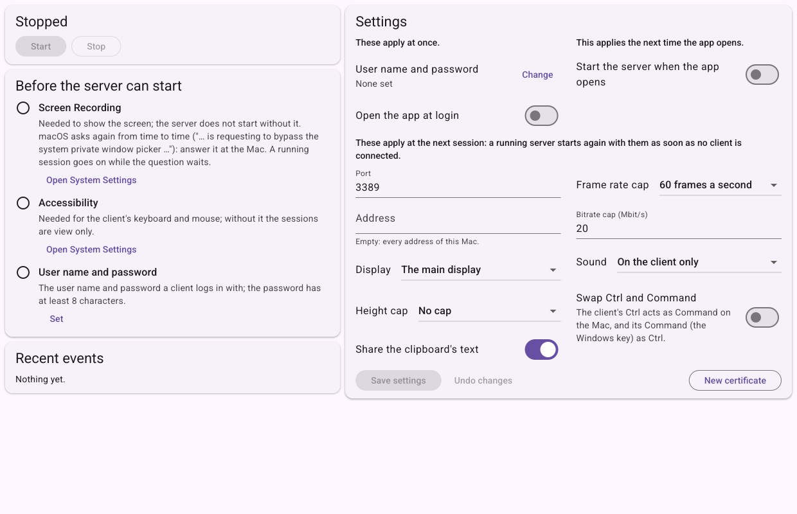
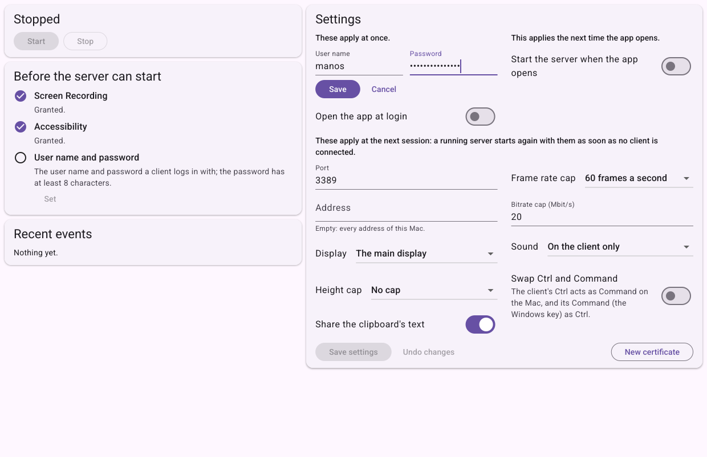
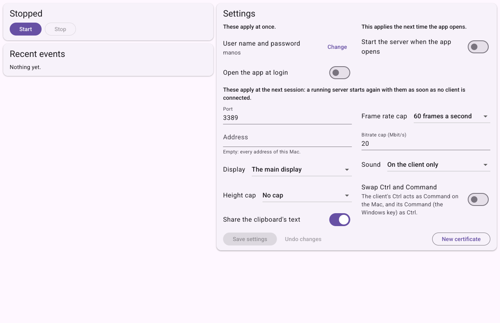
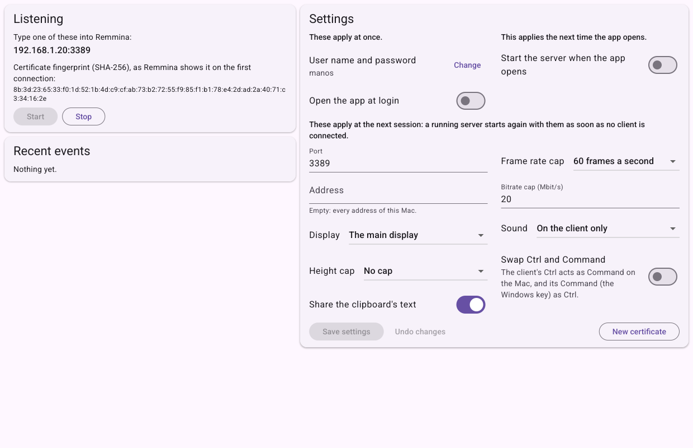
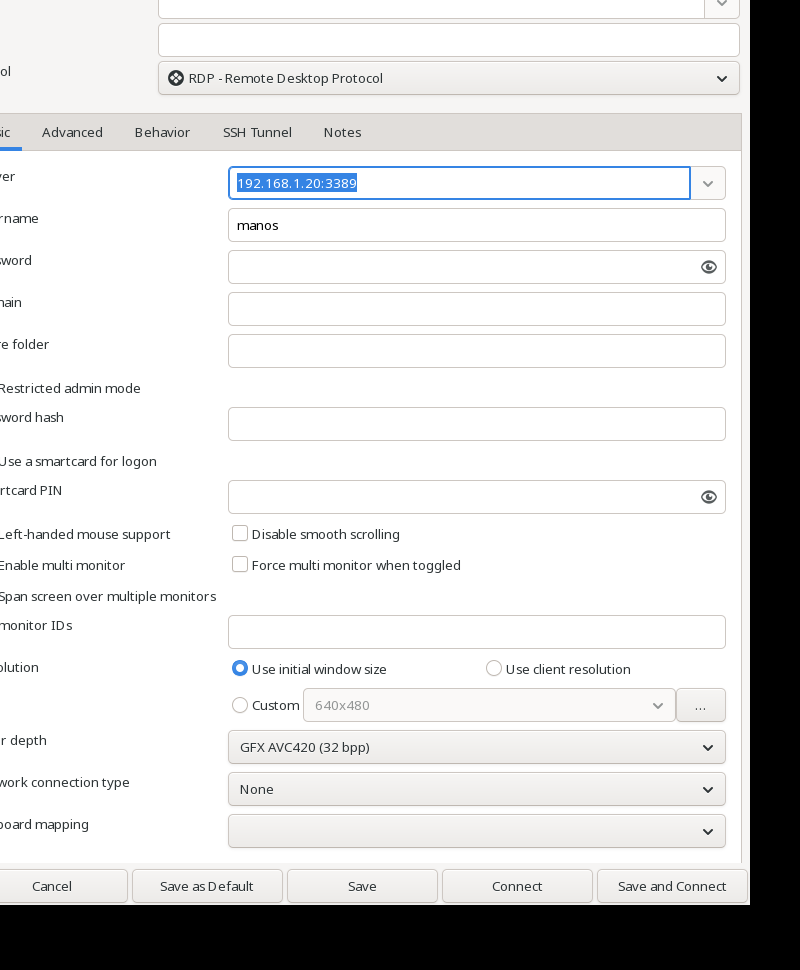
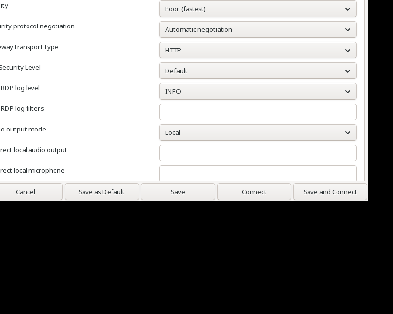
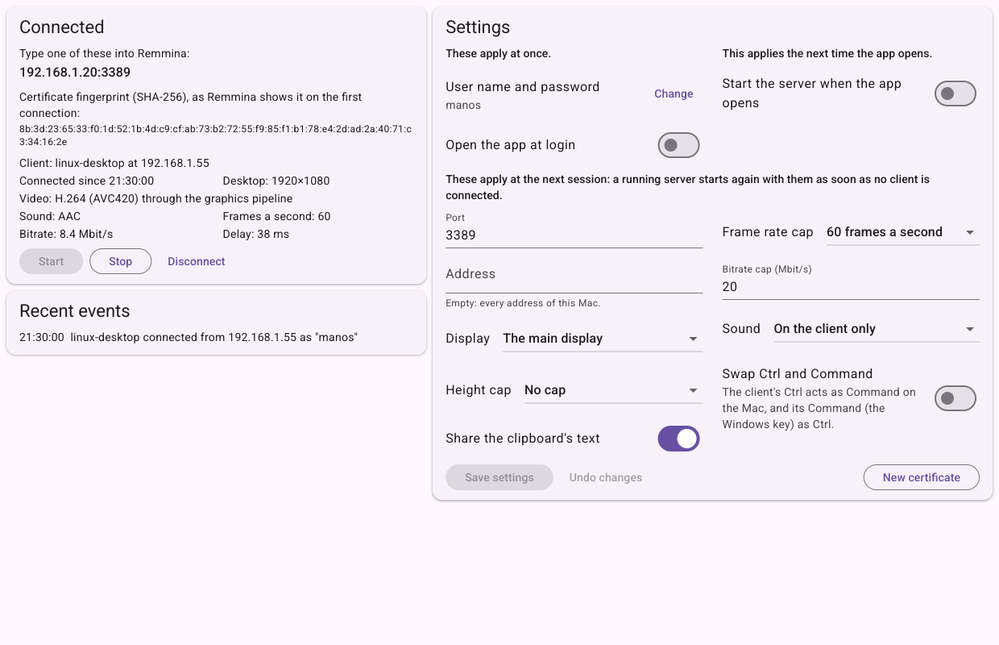
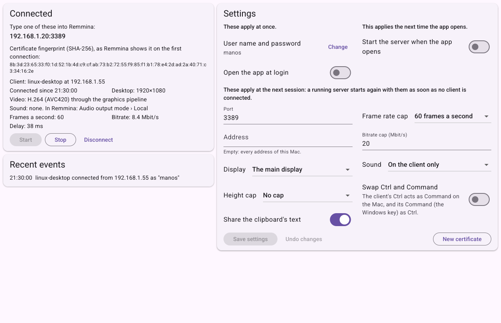

# Setting up mardp on a new Mac, step by step

This guide takes a Mac that has never seen mardp to the point where you watch its screen, with sound, in Remmina on a Linux computer. It needs about 15 minutes, a Mac with macOS 14 or newer, and a Linux computer on the same home network. Nothing here needs programming.

The steps are in three parts:

1. [Install mardp on the Mac](#part-1-install-mardp-on-the-mac)
2. [Set it up the first time it opens](#part-2-the-first-start)
3. [Connect from the Linux computer](#part-3-connect-from-the-linux-computer)

**About the pictures.** The pictures of mardp's window are drawn from the app's own code with example data: the user is `manos`, the address is `192.168.1.20:3389`. Yours will show your own user name, address and fingerprint. The pictures of Remmina were taken in Remmina 1.4.43 on Fedora. The questions that macOS itself asks, and its System Settings, are described in words.

## Part 1: Install mardp on the Mac

mardp is not in the App Store and has no installer to download. The Mac builds the app from its source, with one command.

### Step 1. Get the source

Open <https://github.com/rm4n0s/mardp> in a browser. Click the **tags** link next to the branch name, and under the newest version click **zip**.

Safari unpacks it into your Downloads folder, as a folder named like `mardp-1.0.7`. If your browser leaves a `.zip` file there, double-click it.

### Step 2. Open Terminal

Press Command+Space, type `Terminal`, press Return. A window with a text prompt opens. To run a line from this guide, copy it, paste it into that window and press Return.

### Step 3. Go into the folder

```sh
cd ~/Downloads/mardp-*
```

### Step 4. Run the installer

```sh
sh scripts/install.sh
```

It checks the Mac and says in plain words what is missing. On a new Mac two things are, and it stops at each one:

| It stops and says that this is missing | What you do |
|---|---|
| **Apple's command line tools** | A window from Apple opens. Press **Install** and wait until it is done (some minutes). Then run the line of step 4 again |
| **Go**, the language mardp is written in | Open <https://go.dev/dl/>, download the installer for macOS that ends in `.pkg` (the script says which one), double-click it and follow it to the end. Then run the line of step 4 again |

When nothing is missing, the same command goes on by itself:

1. It makes a **signing identity** for this Mac. macOS asks for your Mac's password once. (The [README](../README.md#the-signing-identity) says why.)
2. It builds the app. The first time it downloads what it needs, which takes a few minutes.
3. It copies **mardp** into Applications and opens it.

From now on mardp is an app like any other: open it from Applications or with Spotlight.

## Part 2: The first start

### Step 5. Look at the window

mardp's window opens. On the left it says **Stopped**, and under it is a checklist, **Before the server can start**, with three things to do once. On the right are the settings; you can leave them all as they are.



### Step 6. Allow Screen Recording

mardp needs it to show the screen and to capture the sound.

1. Under **Screen Recording**, press **Open System Settings**.
2. macOS asks whether mardp may record the screen, and opens System Settings at Privacy & Security › Screen & System Audio Recording (named Screen Recording on macOS 14).
3. Turn **mardp** on in the list. macOS may ask for your password.
4. macOS may say that mardp must quit and reopen. Let it.

The circle next to **Screen Recording** becomes a tick.

### Step 7. Allow Accessibility

mardp needs it so that the Linux computer's keyboard and mouse work on the Mac. Without it you can only watch.

1. Under **Accessibility**, press **Open System Settings**.
2. Turn **mardp** on in that list too.

### Step 8. Choose a user name and a password

These are only for mardp: the Linux computer logs in with them. Do not reuse your Mac's password.

1. Under **User name and password**, press **Set**. A small form opens at the top of the settings.
2. Type a user name, and a password of at least 8 characters.
3. Press **Save**.



### Step 9. Press Start

The checklist is gone and the **Start** button is ready. Press it.



macOS asks once whether mardp may accept incoming network connections. Press **Allow**.

### Step 10. Note the address and the fingerprint

The window now says **Listening**. It shows the two things you need on the Linux computer:

- **the address** to type into Remmina, here `192.168.1.20:3389`;
- **the certificate fingerprint**, a long line of letters and digits. At the first connection it proves that you reached your own Mac and not something else.

Leave the window open, or write the address down.



## Part 3: Connect from the Linux computer

### Step 11. Install Remmina

Install **Remmina** with its RDP plugin from your distribution's software center.

**On Fedora, check the video decoder.** mardp sends video as H.264, which Remmina decodes with OpenH264. Fedora has two packages that provide it, and one of them is an empty stand-in that decodes nothing:

```bash
rpm -q openh264 noopenh264
```

If it says that `noopenh264` is installed, swap it for the real one:

```bash
sudo dnf swap noopenh264 openh264 --enablerepo=fedora-cisco-openh264
```

### Step 12. Make a connection profile: the Basic tab

In Remmina press **+** (new connection profile). Choose the protocol **RDP - Remote Desktop Protocol** and fill in the **Basic** tab:

| Field | What to put |
|---|---|
| **Name** | Anything, such as `My Mac` |
| **Server** | The address from mardp's window, with `:3389` |
| **Username**, **Password** | The ones you set in step 8. Leave **Domain** empty |
| **Resolution** | "Use client resolution", or leave it |
| **Colour depth** (spelled **Color depth** on some systems) | **GFX AVC420 (32 bpp)**. This is what makes video smooth. With another choice the picture is sent as plain images, which is much slower |



### Step 13. Turn the sound on: the Advanced tab

Click the **Advanced** tab and set **Audio output mode** to **Local**. Remmina has it off by default, and without it Remmina takes no sound: the Mac's own speaker keeps playing and the Linux computer stays silent.

Leave **Security protocol negotiation** at **Automatic negotiation**.



### Step 14. Connect and compare the fingerprint

Press **Save and Connect**.

At the first connection Remmina shows a certificate and asks whether to accept it. Compare its **fingerprint** with the one in mardp's window (step 10): they must be the same. Then accept. Remmina remembers it and does not ask again.

If Remmina ever says that the certificate **changed**, and you did not press **New certificate** in mardp, do not connect.

### Step 15. Check what mardp's window says

Remmina shows the Mac's desktop. On the Mac, mardp's window says **Connected** and describes the session. Two lines tell you that everything is set up for video:

- **Video: H.264 (AVC420) through the graphics pipeline**. If it says something else, go back to step 12 (Colour depth) and, on Fedora, step 11 (the decoder).
- **Sound: AAC**. If it says **Sound: none**, see the next picture.



When Remmina did not ask for the sound, the window says so and names the setting to change (step 13). Change it in Remmina's profile and connect again.



### Step 16. Watch a video

Play a video on the Mac, full screen. The picture and the sound come out of the Linux computer; the Mac itself stays silent while you are connected, because mardp's **Sound** setting is **On the client only**.

If the picture stutters, make Remmina's work lighter in mardp's settings: **Height cap: 1080** when the Mac's screen is larger than that, and **Frame rate cap: 30 frames a second**. Press **Save settings**; they apply at the next connection.

## After the setup

- **Closing the window does not stop mardp.** It keeps running, with an icon in the menu bar. The icon's menu has **Show window** and **Quit**.
- **To reach the Mac after every login without touching it**, turn on both **Open the app at login** and **Start the server when the app opens**.
- **Copy and paste of text** works between the two computers, both ways.
- macOS asks again from time to time whether mardp may go on recording the screen. That has to be answered at the Mac itself.

The [README](../README.md) describes every setting, [what to do when something is wrong](../README.md#when-something-is-wrong), and how to [update or remove](../README.md#updating-and-removing) mardp.
